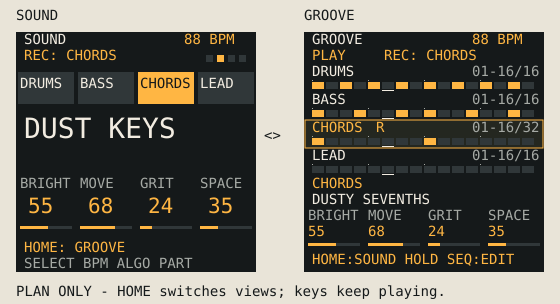

# Two Home views: Sound and Groove

Status: implemented and software-verified, 2026-10-14. This document specifies the
current two-view controls and display contract from [First device feedback](FIRST_DEVICE_FEEDBACK.md#2-sequencer-prominence-two-home-views).
The shared native/browser checks and updater-enabled FM-1 build passed.
Publication and physical audition remain pending. Outcomes are tracked in the
[Home views build record](build-evidence/home-views.md).

## 1. Playing experience

Home has two views of the same session:

| View | Main purpose | What stays visible |
| --- | --- | --- |
| SOUND | Choose a sound and shape it with the four macros. | Tempo, transport, part selection, large sound name and macro values. |
| GROOVE | See how the four patterns fit together while playing. | Tempo, transport, four step rows, selected sound and compact versions of the same macros. |

These are two views of the same live session. Switching does not change the
selected part, notes, sound, pattern, tempo, recording, or knob assignments.
Both views keep the keyboard playable, including chord building and SNAP.

Navigation:

- Tap HOME on SOUND: show GROOVE.
- Tap HOME on GROOVE: show SOUND.
- Tap HOME from a normal sound/scale/sequencer page: return to whichever Home
  view was used last. Do not immediately toggle it.
- Returning Home through another action, such as leaving the drum editor,
  also restores that remembered view.

**GROOVE is the confirmed power-on view**, so the beat and recording are
immediately in view. Subsequent choices are remembered for the current powered
session. Changing sounds or starting a fresh musical session keeps that choice.
Remembering it across power cycles belongs to the later settings-storage work.

Example: GROOVE → HOME → SOUND → ENV → HOME returns to SOUND; the next
HOME tap switches to GROOVE. A SOUND/GROOVE heading and the opposite-view name
in the HOME footer identify the current view and the next action.

## 2. Controls and gesture priority

| Control | Action in either ordinary Home view |
| --- | --- |
| MASTER | Output level. |
| SELECT | Tempo, one BPM per detent, 40–240 BPM. |
| ALGORITHM | Select Drums, Bass, Chords or Lead. |
| PRESETS | Change the selected part's sound, preserving its pattern. |
| Knobs 1–4 | The same four named sound macros in both views. |
| Note keys | Play notes/chords or drum pads; GROOVE does not turn them into step switches. |
| PLAY / REC | Existing transport and recording actions. |
| OCT− / OCT+ | Existing octave/part-specific behavior. |
| SEQ | Existing sequencer pages/layer; explicit editing remains separate. |

The overview's compact macros show the selected part's macro labels and values.
The knobs retain the same sound parameters as SOUND; they do not adopt the
inherited TRACKS view's swing/level/steps/pan controls. Unsupported sound
engines retain `EDIT` / `--` indications.

HOME needs the following precedence, beyond the simple navigation rule:

1. A hold still opens/closes settings after the existing approximately 700 ms
   threshold. Its release must never count as a view-switch tap.
2. A short HOME tap in settings closes the menu to the remembered Home view.
   This uses `menu_close()` and consumes the gesture without toggling afterward.
3. Held SEQ + HOME retains its existing layer-lock action. HOME used to
   unlock a held layer is consumed by that action, without switching Home
   views. Preserve the other held-button combinations and release orders.
4. Armed-recording, free-take, count-in and hold-to-confirm overlays retain
   their input/display ownership. HOME must not secretly change the remembered
   view behind them, cancel a take, or confirm a destructive action.
5. Ordinary playback and overdubbing, with Home actually visible, allow
   toggling freely while notes and audio continue.

Classify HOME ownership when it is pressed and check it again on release.
If another layer owned any part of that gesture, do not reinterpret the
release as an ordinary Home toggle. Test HOME together with PLAY: the current
layer handler intentionally lets PLAY continue through some early returns.

## 3. A readable 240×240 layout

SOUND retains its large controls while GROOVE gives patterns space.

The drawing remains a static design wireframe, not a screenshot of this build.
Its typography budgets use the existing small font's 8×16 character cells.

| GROOVE screen region | Height | Content |
| --- | ---: | --- |
| Header, y 0–31 | 32 px | GROOVE, BPM, play/stop and recording state. |
| Four rows, y 32–143 | 112 px | Drums, Bass, Chords, Lead; 28 px each. |
| Selected sound, y 144–175 | 32 px | Selected role and readable sound name. |
| Four macros, y 176–215 | 40 px | Four columns with labels, values and compact bars. |
| Footer, y 216–239 | 24 px | `HOME: SOUND  HOLD SEQ: EDIT`, or a temporary status message. |

Each row has a 16 px text line and a small 16-cell step strip. Use the full
224 px inset width for the strip: 16 cells at 14 px pitch, with visible gaps
and beat-group accents every four steps. Selection uses an outline/side mark
as well as color; playhead, stored notes and mute must be distinguishable.
Long names truncate safely within their own region. No scrolling text is
needed for the first version.

## 4. What the sequencer display means

- Each cell is one **actual stored step**, not a compressed summary of several
  steps. Filled cells show programmed notes/hits; a different line mark shows
  melodic ties; empty cells show no event. Out-of-length cells are disabled.
- The drum row summarizes whether any drum lane has a hit on that step.
  Individual kick/snare/hat editing stays in the drum/SEQ editor.
- Every row shows its own range and total length, for example `01-16/32` or
  `17-32/64`. Support all current lengths from 1 to 64, including a partial
  final window. These are step ranges, not guaranteed musical bars.
- While playing, each row follows that part's actual playhead and 16-step
  window. Parts can have different lengths and step divisions. Show the DIV
  value when it differs from the usual 1/16; do not imply a shared time scale.
- On stop, retain the last displayed window for each row. Before any playback,
  show its first window. Clamp a remembered window after a length change and
  reset it for a genuinely replaced pattern/session. Do not reuse or move the
  step editor's cursor to achieve this.
- Keep stored cells visible when muted. Show explicit mute, solo and recording
  separately from the selected-row marker. Also dim parts excluded by another
  solo or with zero level. Do not relabel every silent part as manually muted.
- A playhead shows sequencer position; a stored cell does not promise an audible
  hit. Conditions, muted drum lanes, swing/microtiming, arpeggiation and live
  input can change what is heard. Existing keyboard LEDs show playing notes;
  a full audio-event visualization is outside this first layout increment.

GROOVE is a performance overview. Chord names, individual note pitches,
velocity editing and a second editing cursor are outside this increment.
Holding SEQ shows the existing editing layer; holding SEQ and tapping HOME
locks that layer. A quick SEQ tap opens the remembered STEP/PATTERN/SONG page.
Both Home views continue to show the selected part's actual sound and macros.

## 5. Implementation boundaries

| Area | Implementation change |
| --- | --- |
| [UI state and `go_home`](../firmware/src/ui.c) | Add a small RAM-only Home-view enum. Both views keep `ui.home == 1`; `go_home()` returns without toggling. Preserve its ordinary exit cleanup. |
| [HOME input](../firmware/src/ui_input.c) | Handle deliberate view switches only in the JamBox ordinary-tap path, with press/release ownership and consumed-gesture checks. Add the explicit menu-return behavior above. |
| [Home renderer/input](../firmware/src/jam_ui.c) | Keep one guarded control handler, dispatch two cached renderers, and invalidate their caches on view changes. |
| [Existing TRACKS view](../firmware/src/ui_studio.c) | Reuse row-drawing ideas and pattern helpers, not its page scope, controls or stopped-pattern folding behavior. |
| [Draw precedence](../firmware/src/ui_draw.c) | Preserve menus, recorder and layer precedence ahead of Home. |
| [Browser adapter](../firmware/host/jam_emu.c) / [worklet](../web/emu/worklet.js) | Append an explicit Home-view value for browser labels/tests while preserving existing `home` and control-ownership fields. Both screens still come from shared C. |

Keep Home out of `FAM_SEQ`, `SC_STEP` and `SC_DRUM`: those scopes change what
keys and controls do. Retain the existing role-to-track mapping rather than
assuming visual row order equals internal track order.

Use the existing 240×124 strip canvas. Draw/copy one bounded strip or row at
a time, with per-row change detection; no new full-screen framebuffer or
audio-thread work. Include every visible distinction in cache keys: selection,
length/window, playback position, division, mute/solo/record state, note/tie
occupancy and displayed macro/sound values. Do not keep interrupts disabled
through hashing, drawing or LCD transfer.

## 6. Delivery and acceptance

1. Set the agreed GROOVE startup view explicitly, rather than relying on enum
   numbering. Check the rendered views at native size and enlarged against
   the wireframe and navigation contract.
2. Implement the view state and HOME navigation with the existing Sound screen
   retained. Verify ordinary taps, returns, menu exit, holds, layer locks and
   both release orders before adding the pattern renderer.
3. Add GROOVE rows, compact macros, transport/recording states and truthful
   16-step windows. Keep controls and the musical keyboard identical in both.
4. Extend the existing Home/native/browser harnesses. Verify toggling while
   holding single notes/chords and during playback/overdub; compare musical
   state and recorded patterns before/after. Test all return routes, repeat
   taps, simultaneous HOME/PLAY, recorder overlays and unsupported macros.
5. Check 1/15/16/17/32/64-step patterns, unequal lengths/divisions, ties,
   partial windows, empty/muted/solo tracks, selection changes and cache
   invalidation. Verify no fake playhead while stopped, no stale screen
   fragments, bounded LCD transfers and stable audio under rapid switching.
6. Build the updater-enabled FM-1 target and browser from the same source;
   verify memory fit, installer packaging and published bytes. Then audition
   both views and HOME gestures on the physical unit.

Native and browser checks and the updater-enabled target build passed;
publication and physical audition remain pending in the
[Home views build record](build-evidence/home-views.md). Persistence, a redesigned
step editor, arrangement tools, per-drum-lane Home rows and new knob modes remain
separate later work. Switching views must preserve the musical session and
continue audio and recording without interruption.
