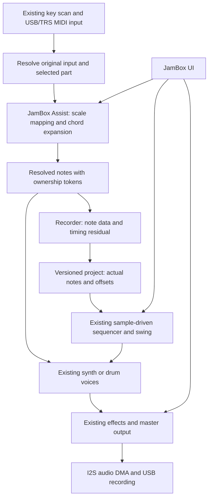

# JamBoxFM implementation plan

Decision date: October 13, 2026. Status: implementation roadmap. The first Dusty palette, Home and shared-code browser slice are now implemented; see [README](../README.md) and [cloud setup](CLOUD_SETUP.md) for current scope and validation. The remaining sections describe intended work, not completed capabilities.

The user-facing requirements are in [PRODUCT_BRIEF.md](../PRODUCT_BRIEF.md). Source evidence, executed checks, and remaining uncertainties are in [RESEARCH_EVIDENCE.md](RESEARCH_EVIDENCE.md). Bring-up and release gates are in [VALIDATION_PLAN.md](VALIDATION_PLAN.md).

The October 14 chord-builder follow-up implements a narrower part of section 4:
QNT controls OFF/SNAP/WHITE independently of CHORD, MAJOR/MINOR/DIM add fixed shapes,
and local keyboard chords retain their resolved notes through release. Enabling
CHORD selects POLY on melodic parts, and SEL 2 exposes ROOT/AUTO/+1/+2/+3
inversions beside the existing STRUM control. Dusty Chords now defaults to SNAP.
The [current chord controls](CHORD_BUILDER.md)
and [first-device feedback](FIRST_DEVICE_FEEDBACK.md) distinguish this work from
the remaining master Assist, external-MIDI/playback ownership, new-input-only
setting changes, timing correction, sequencer Home and persistence proposals.
The original chord build's software results are in its
[build record](build-evidence/chord-builder.md). The later October 14 lighting
request replaces root-only chord feedback with pressed keys plus all sounding
notes on the selected part, using printed note positions in the selected
octave across OFF/SNAP/WHITE and transpose. Single-note SNAP still shows its
pressed and corrected notes without unrelated aliases. This lighting
follow-up's software checks and publication are in the
[lighting build record](build-evidence/sounding-note-lights.md); physical
audition remains separate.

## 1. Main decision: use Sloop's device engine as the first baseline

Pin `isod89/sloop-fm1` at `8fad1a15ff59d5c3ed0bfe2d7a9ae90962cf4d5e` for the first branch of implementation.

This decision concerns the engine and hardware support. JamBox's controls, starting sounds, screen hierarchy, and novice workflow will be designed around the agreed brief. The owner dislikes Sloop's sound selection and complexity; preserving those unchanged would not satisfy the goal.

Sloop already has three synth parts sharing eight voices, plus a separate six-voice drum system. That directly supports our internal roles: bass, chords, lead, drums. Current Felucca instead shares eight voices across its four general tracks, including a DRUM engine, leaving less room for sustained chords alongside drums. Sloop also supplies sequencing, swing, microtiming, MIDI, persistence, an update loader, and a browser DSP build. [S1], [F1]

| Reference | Reuse or learn from | Boundary |
| --- | --- | --- |
| Sloop, pinned above | Drivers, audio/voice/drum architecture, clock, sequencer, storage primitives, packager, browser DSP adapter | Rework interaction and sound curation; retain a measurable baseline |
| Felucca `1727537624390cc3f9c7dff2456b43b3a8edb005` | Ancestor design, subsystem tests, fixes worth comparing | Review individual changes; it has different voice, project, and memory layouts |
| Ghoulbox `2f001b1f550eac695d8400f9f388c8eac6dbb4c6` | Coherent sound identity; firmware UI compiled into a browser simulator | Its art, new engines, voice count, and full simulator are not prerequisites for the first slice |
| ChoralRoot `aa5875af20e3046ee161f988c5d91d3ae66d0c74` | Chord UX, portable musical logic, update compatibility checks, boot-stub design | Its semantic chord looper and flash layout do not drop into Sloop unchanged |
| Baud Girl | Device/library-management UX reference | Implementation and license remain unverified because the site was inaccessible |

Keep the existing single-translation-unit build initially. Introduce small `jam_*` modules through the existing `firmware/src/felucca.c` composition rather than changing the compiler, runtime, drivers, and build system at the same time.

## 2. Device architecture



Preserve the existing ownership of real-time work. The timer IRQ scans the physical matrix and services USB/UART; `mix_block()` calls `events_block()` before rendering synth parts and drums. The UI stays outside the expensive audio path. Reuse current MIDI queues and request mechanisms; add only bounded commands where the new UI needs them. [S2]

Do not introduce allocation, file I/O, font generation, flash erasure, or blocking locks into audio rendering. Assist is bounded integer/table work. Browser controls must enter the same musical command path as the device UI; they must not implement a different chord generator in JavaScript.

### Proposed module boundaries

These are the full planned module boundaries. The first slice implements `jam_palette.c` and the Home portion of `jam_ui.c`; the other additions remain planned.

| Planned module | Responsibility | Existing seams |
| --- | --- | --- |
| `jam_core.h` | Role IDs, bounded command types, Assist data, module declarations | `core.h`; declared early in `felucca.c` |
| `jam_assist.c` | Input-only scale/chord mapping and enable policy | `seq.c`: scale helpers, `chord_notes`, keyboard/MIDI note-on |
| `jam_notes.c` | Resolved note ownership; matching releases after mode/part changes | `voice.c`: `trk_note_on/off`; `seq.c`: `input_on/off`, stored-note playback |
| `jam_record.c` | Record timing strength and residual; recording transaction/undo | `seq.c`: `rec_target`, `rec_note`, `rec_hit`, `rec_hold`, `undo_mark` |
| `jam_session.c` | Four roles, palette application, new session, variation transactions | `main.c` initialization; track defaults, presets, sequencer operations |
| `jam_palette.c` | Curated sounds/grooves and per-sound macro descriptors | `engines.c`, presets, synth drum kits, `params.c`, `fx.c` |
| `jam_ui.c` | Home, Assist, sound pages and modal confirmation | `ui.c`, `ui_layers.c`, `ui_draw.c`, `panel.c` |
| `jam_project.c` | JAM1 encoding/validation and explicit imports | `project.c`, `storage.c`, backup/archive handling |

Use declarations to preserve the existing inclusion dependencies. Compile after each integration seam is added; do not duplicate the whole sequencer or mixer to get around ordering problems.

## 3. Four parts and an initial audio budget

Keep Sloop's internal indices stable; translate only the display order:

| Home order | Label | Internal track | Initial held-voice policy |
| --- | --- | --- | --- |
| 1 | Drums | 3 / `TRK_DRUM` | Existing separate pool: up to six drum voices |
| 2 | Bass | 0 | Mono; one held synth voice |
| 3 | Chords | 1 | Up to four held synth voices |
| 4 | Lead | 2 | Mono initially; one held synth voice |

Six held synth voices leave two of the eight shared slots available for transitions/releases. This is a proposed role policy to implement and test; the present allocator does not guarantee it. Long releases, overlapping chords, and engine-specific voice limits still compete for resources. Prefer released/old voices when stealing, preserve the bass/lead role caps, and expose overload diagnostics during development. [S1], [S3]

Apply the chord limit to held note groups before allocation, not by simply reducing the part's available voice slots to four: that would also eliminate room for release tails. For one-key chords, the most recent chord trigger replaces the preceding live group; retire its ownership tokens safely so releasing an older held key cannot stop the new chord. Live playing on the Chords part temporarily takes priority over its pattern chord. After the live group releases, the pattern resumes at its next chord onset. Raw playing with chord assistance off accepts up to four held notes and visibly refuses additional notes until a slot is released. Test these policies before introducing more elaborate layering.

Start with the existing analog engine and synthesized drum kits. Audition an existing FM engine for electric-key-like chords only after checking its four-voice workload. Curate new presets rather than adding a new synthesis engine in milestone one.

| Palette | Initial sound construction |
| --- | --- |
| Dusty | Synthesized dusty kit, round bass, mellow chords, gentle pitch/filter movement, modest drive and delay |
| Garage | Punchy kit, short bass, percussive chord envelope, restrained distortion, short room/echo |
| Neon | Bright kit, pulsing bass, open-filter chord/lead patches, chorus and tempo-related delay |

Build one palette first, proposed **Dusty**, and listen with the owner before investing in the other two. Artist references are listening targets, not promises of exact guitar, sample, or record reproduction.

Use the existing shared effect buses and per-part sends. No unison by default; avoid several expensive inserts on top of four-note chords. A sound's four Home macros should address useful underlying parameters—e.g. brightness, movement, grit, space—with per-preset ranges. Parameter changes should use existing smoothing where available. Deeper pages still expose oscillator, envelope, filter and effect controls.

For ANALOG, the first concrete mappings are Brightness → `P_E4` cutoff, Movement → a restrained filter-LFO depth/rate, Grit → `P_DIST`, and Space → a curated delay/reverb send curve. DIGITAL keys can map Brightness to FM modulation index and Movement to gentle tremolo. Bass starts mostly dry. These ranges require listening and render tests; parameter names alone do not establish usable sounds.

Muted parts and zero effect sends do not automatically free CPU or buffers. If needed, remove unused punch-in looping/stutter processing through explicit, tested build options: their source buffers alone total 96 KiB. This requires code changes; `FELUCCA_SLICE=0` only disables a separate synthesis engine. A runtime bus bypass must handle audible tails before skipping its work. [S8]

### Limits to preserve and measure

- Sloop's device audio uses 256-frame DMA halves, approximately 5.8 ms at nominal 44.1 kHz, with 32-sample control/render blocks. Retain that latency until the unmodified and modified device measurements exist. A browser's 128-frame worklet callback is not the device's DMA buffer size. [S1], [S2]
- Linker windows: `XIP` length `0x8DFBC` (581,564 bytes), ordinary RAM 96 KiB, large-buffer pool 336 KiB, plus distinct RAM-code, stack and retained-state regions. These are capacity limits, not measured free space. [S4]
- Provisional incremental RAM ceiling: 4 KiB beyond the selected baseline for Assist ownership, recording/undo extensions and commands. This is an engineering target, contingent on actual linker headroom.
- Keep the build's minimum 8 KiB pool headroom check and add a minimum 4 KiB ordinary-RAM headroom check. Both the incremental growth cap and remaining-space checks must pass. Add explicit retained-state size checks. Remove unused feature/UI code before enlarging any memory partition.
- Provisional hardware target: sustained total audio-interrupt duration p99 below 70% of the half-buffer deadline, maximum below 85%, and no underruns or overload-triggered shedding under the supported palette stress case. Include nested timer/USB work; the displayed smoothed CPU percentage subtracts that work and is insufficient. These are acceptance targets, not current measurements or guarantees. Fading voices still cost CPU, and the synth-shedding routine does not shed the independent drums.

## 4. Input-only Assist with reliable note release

The following remains the full target contract. The current chord-builder
increment uses the existing SEL pages, adds fixed shapes and manual inversions,
selects POLY for full chords, and corrects the local keyboard mapping/overlap
behavior. It does not implement the master switch,
external source tokens or all live-versus-sequencer ownership described below.

Provide a master Assist switch, per-part enable state, and separate one-key-chord, scale, and timing choices. Defaults: chord help on the Chords part, scale help on Lead, gentle record correction. A global bypass preserves the stored individual choices.

Reuse Sloop's existing scale and chord formulas where suitable: triad, seventh, reduced four-note ninth voicing, suspended and power-chord forms. Begin with a small visible choice set; keep the implementation table extensible. [S5]

For a live note-on:

1. Identify its physical/MIDI source and the target part at that instant.
2. Read a consistent snapshot of that part's Assist settings and existing root/scale parameters.
3. Map to the selected scale if enabled; expand into at most four absolute MIDI notes if chord mode is enabled. Drum input bypasses harmonic mapping.
4. Store the original source, original part, resulting pitches, and relevant output channel in a bounded ownership record.
5. Pass the resolved notes to sound generation and, when armed, the recorder exactly once.

For note-off, release the pitches and part stored at note-on. Do not recompute them using the current key, selected part, chord mode, or Assist switch. Changing settings while a key is held affects the next note-on; it must not leave a stuck chord.

Use existing local-key records where possible. A proposed additional bound is 24 simultaneous external-MIDI source records; on exhaustion refuse the new assisted note with a visible diagnostic, retaining all old release records. Never fall back silently to an unmapped pitch. Preserve sustain-pedal behavior and handle disconnect/panic.

Add ownership tracking between live input and pattern playback where they converge on pitch-based `trk_note_off`. A sequencer note ending must not release a matching live-held pitch, or vice versa. Define the shared-pitch retrigger policy explicitly: a new owner may retrigger the sound, but the gate remains held until its last owner releases. This bounded policy does not promise independent envelopes for identical pitches.

External MIDI assistance is opt-in initially. Recorded pattern events bypass Assist. Playback must not feed its own events back into recording.

Preserve USB versus TRS source identity at queue ingress: Sloop's current normal UART channel packets do not retain the same source tag used for realtime clock messages. A `(port, channel, original note)` token key requires that small queue-format change and corresponding tests. Do not infer a port from an untagged packet. Keep ARP off in the first palette; enabling it later requires immutable resolved-note input so its current remapping of held notes cannot defeat Assist's new-input-only rule. [S9]

## 5. Recording, timing, swing, undo

### First loop representation

Keep the 64-step storage capacity, with a default two-bar loop of 32 sixteenth-note steps in 4/4. Synth steps hold up to four absolute notes and existing tie/velocity flags; drums use their existing 16-lane representation. [S6]

Store the actual expanded chord pitches, not just a root and recipe. Sloop already plays its stored pitches directly. Turning Assist off or changing a chord recipe must leave recorded harmony unchanged. ChoralRoot's semantic chord-event looper is a useful reference but would revoice playback; do not substitute it wholesale.

A first-version limitation is explicit: chord notes on one step share onset microtiming and duration/tie behavior; drum hits sharing a step share its microtiming. This is a grid recorder with fine offsets, not unrestricted independently timed multitrack audio or MIDI capture. Longer/free-form recording needs a later format and budget.

### Record timing correction

Sloop's existing `rec_target()` chooses a nearby step and accounts for estimated input/output latency, but `rec_note()` and `rec_hit()` do not currently capture the performance into `micro[]`. Implement that residual capture. [S6]

Compute timing against the same swung grid used by playback, using the existing latency compensation as the first device baseline. Host tests use zero known latency; browser and external-MIDI adapters need their own measured/declared offsets rather than inheriting the physical key-scan compensation. Round the residual to the stored 1/64-step units:

- **Off:** retain the representable timing residual.
- **Gentle:** move the new residual halfway toward zero.
- **Tight:** store zero residual.

Apply this once when recording. Do not retime every saved step when the setting changes. Clamp to the existing signed six-bit range and define nearest-step tie-breaking, especially across swung boundaries and loop wrap. Measure device latency before changing `REC_LAT`; browser timing is not evidence for that value.

Match playback's normalization exactly: early negative offsets refer to the preceding swung segment; positive offsets refer to the current segment. Retain the recorded-note skip mechanism so immediate monitoring is not followed by a second attack at the scheduled onset. Commit an assisted chord as one group; replacing a full chord step must not produce a mixture of three old tones and one new tone through repeated single-note insertion.

For additional notes/hits overdubbed into an occupied step, preserve that step's existing microtiming. A new pass that explicitly replaces a step can choose new timing. This avoids moving an existing snare when adding a hi-hat to its shared step; expose the limitation in advanced documentation.

### Swing

Keep swing separate from Assist. Sloop's existing 0–100 control corresponds to a 50:50 through 75:25 long/short pair; zero is straight. Preserve its handling of triplet and long-note divisions. Let the new UI expose a simple amount and part scope. [S7]

Changing swing changes scheduled playback, not stored event data. Capture new performances relative to the swung grid so swing is not applied twice. Test early/late steps, tempo changes, ties and the first step of a loop.

### Undo and variation

Extend existing single-track undo. The current snapshot keeps steps and length but not all microtiming/lock/fill state. A JamBox take must restore all fields it changes, including microtiming and relevant locks/fill data. A new recording pass is one undo transaction. [S6]

Keep one reliable undo/redo level initially. A small variation operation can change velocities or selected drum hits within a bounded rule and must use the same snapshot path. A whole-session palette replacement is a separate stopped-transport operation with confirmation; do not claim a single-track snapshot can undo it.

## 6. Physical controls and screen proposal

The source maps 27 note keys, 14 labeled buttons, seven endless encoders, LEDs and a 240×240 screen. Encoders are not assumed to have push switches. The button Sloop calls `SEL` is `B_SCL` internally. Keep raw scanning, debouncing, encoder calibration, LED multiplexing and display drivers. [H1]

The Home encoder rows incorporate the owner's 2026-10-14 follow-up request.
The remaining rows describe the broader planned controls; they do not imply
that all proposed features are implemented:

| Control/context | Planned action |
| --- | --- |
| HOME | Return to the four-part overview |
| SELECT encoder on Home | Tempo, one BPM per detent, 40–240 BPM |
| PRESETS encoder on Home | Browse curated sounds for the selected part |
| ALGORITHM encoder on Home | Select Drums / Bass / Chords / Lead; display selected role clearly |
| Knobs 1–4 on Home | Selected sound's four labeled macros |
| PLAY | Existing play/stop behavior |
| REC | Arm/disarm selected part using the existing transport state machine; retain visible count-in/armed state |
| SEL (`B_SCL`) | Open Assist; SELECT chooses a row, Knob 1 edits it; HOME exits |
| SEQ | Show the selected pattern and step editing; retain a visible playhead |
| ARP | Rhythm/arp page; disabled in the initial palette until the resolved-note ownership tests pass |
| EDIT | Open deeper sound controls; SELECT chooses rows, knobs edit labeled values |
| FX / ENV / LFO | Direct access to their corresponding sound pages |
| GLO | Session menu: tempo, swing, key/scale, palette, and part mute controls |
| SAVE | Save workflow; in an explicit palette-confirmation modal, confirm the pending stopped-session replacement |
| OCT− / OCT+ | Existing octave behavior; maintain reserved boot/calibration/recovery combinations |
| EDIT + OCT− / OCT+ | Retain upstream undo/redo gesture; show its meaning on the relevant page |
| MASTER potentiometer | Existing master loudness behavior, always available |

Modal handlers must consume a confirmation gesture so SAVE cannot both apply a palette and save a different slot. Palette changes that replace patterns happen only while stopped, after explicit confirmation. Ordinary sound browsing must preserve the recorded pattern, following pinned Sloop's explicit sound-loading contract.

Key/scale rows in GLO and Assist edit the selected melodic part and show its name. A separate explicit `Apply key to all melodic parts` command can synchronize them; do not present per-track values as an unexplained global key. Palette initialization sets consistent defaults across the melodic parts. SAVE must distinguish a queued save from a completed flash commit and wait for the inherited stopped/quiet condition.

Home shows the palette/project name, tempo, playing/recording state, four role/mute indicators, selected sound, Assist status and four macro labels. Use the existing drawing/font system first, short labels, strong selection contrast, and bounded redraw work. Colors and branding are still a design task; no artwork direction has been finalized.

A performance shortcut for mute can be added after the first mapping is tried. Start with explicit per-part mute rows rather than inventing another unlabeled held-button layer.

## 7. Save format that fits the existing flash layout

Keep Sloop's physical sector map and A/B commit-last storage mechanism. Its current project is 3,816 bytes; one storage object permits 3,840 bytes. Use a distinct **JAM1** project identity and append exactly 24 bytes of versioned metadata before the project checksum. [P1]

Proposed byte-level extension:

| Bytes | Field |
| --- | --- |
| 0 | Extension version: 1 |
| 1 | Master Assist enable, reserved bits zero |
| 2 | Palette ID |
| 3 | Role/voice-policy version |
| 4–7 | Variation seed, fixed little-endian encoding |
| 8–23 | Four internal-track records, four bytes each: enable/chord/scale flags, record-correction enum, chord recipe, input-source policy |

Retain existing root/scale and sound parameters in their existing fields. Preserve internal track order 0/1/2/3. Explicitly encode fields and checksum; do not rely on an arbitrary host compiler's struct packing. Add `_Static_assert(sizeof(jam_project_t) == 3840)` where a device struct mirrors the encoding, exact encoded-length checks, and golden byte fixtures. [P1]

Validate every enum, root/scale value and reserved bit. Reject unsupported versions. There is no room left for unrelated new data in this schema. Additional recording formats or automation require a new design rather than silently appending bytes.

Four retained project slots grow by 96 bytes. Check the complete `.noinit` region including calibration/settings and other globals before accepting this layout. The slot payload fitting flash does not prove the retained-state region fits RAM.

The source audit totals 15,560 bytes for the enlarged four slots plus existing retained globals, versus a 15,696-byte region, leaving only 136 bytes before alignment. The existing test's conservative 256-byte allowance for ancillary state leaves 80 bytes. Treat this as tight: require the target linker to confirm the bound and keep all new live Assist/undo/ownership state outside `.noinit`. [P2]

Use a JamBox storage-family discriminator so foreign settings/presets/autosaves are not implicitly treated as valid. Audit every boot reader, not just projects. Begin with a clean in-memory session on unknown data; do not immediately autosave defaults over it. Read-only export and an explicit initialization step must precede reuse of existing storage sectors. This deliberately overwrites old data when the user chooses it; backing up is required for returning to Sloop later.

A Sloop importer is a later, explicit operation on a verified backup with a known version. Preserve existing user data during first bring-up. No automatic promise of Sloop/Felucca/ChoralRoot project interchange.

A project is not necessarily self-contained. Backups must also include referenced FM6 banks, user drum kits, sample slots and applicable settings; restoring JAM1 bytes alone must not be labeled a complete sound restoration. Preserve hardware calibration through a narrowly validated path, separate from foreign musical settings.

## 8. Browser development path

First extend Sloop's existing `firmware/host/preview.c` adapter and `web/preview-worklet.js` rather than building an unrelated browser synth. A worklet owns the WASM instance; commands enter shared Assist, note, record and session functions. [W1]

The first browser interface should mirror the Home/Assist workflow and keyboard/encoder semantics. It can use HTML controls, but all musical decisions belong in C. Rendering the exact device LCD through a simulated HAL is a later parity milestone, informed by Ghoulbox and ChoralRoot. Do not call the first DSP preview a full device emulator.

Preserve explicit user-start for audio, report unsupported sample rates, and stop/release held inputs on lost focus. Existing Sloop requires 44.1 kHz and fails clearly on another rate. Retain that rule until a deliberate resampler is implemented and tested. Keep transport position driven by audio, not animation frames or JavaScript timers.

Use a bounded command queue and coalesce repeated parameter changes. Keep sample/kit transfers and large state copies away from active audio deadlines. Full project changes occur at a controlled boundary, not halfway through serializing UI state.

## 9. Build, package and installer path

Keep Python asset generation, the JieLi pi32v2 device compiler, and Emscripten as separate build targets. Linux x86-64 runs the device compiler natively. A plain ARM compiler does not target this chip. [B1]

The exact three SDK files vendored in the pinned ChoralRoot tree match the SHA-256 values expected by both inspected Sloop and Felucca builds. That subset can be a reproducible dependency after preserving its Apache-2.0 notices. A new minimal SDK copy must retain the original directory structure and pass an explicit fail-closed hash preflight. The upstream build's warning on mismatch is not sufficient. [B2]

The vendor toolchain fetch script currently points at a moving HTTPS download. Record the actual archive/version/digest after trusted acquisition and pin it; no archive version/checksum is invented in this plan. Similarly record and pin the tested Emscripten and host Clang versions before claiming reproducible builds. Toolchain acquisition is still outstanding.

After importing the pinned baseline, the first commands are structurally:

```sh
# Run inside the isolated JamBox checkout, with verified tools prepared first.
export JIELI_TOOLCHAIN=/workspace/toolchains/jieli/toolchain
export AC79_SDK=/workspace/deps/ac79-sdk
./build.sh

# Emscripten must be active in this shell.
python3 tools/build_preview.py
CC=clang sh tests/run_preview_tests.sh
```

These are planned baseline commands, not commands that have all passed in this environment. Further commands and prerequisites are in the validation plan.

Produce the hardware app, loader and `.fwsc`, plus a build manifest containing source commit, compiler identity, feature flags, firmware family, schema version and SHA-256. Make the browser JS/WASM manifest part of the same release.

The custom install page can be a static HTTPS site, including GitHub Pages. It fetches our release manifest and package, requests Web MIDI access with SysEx, and talks to the FM-1's USB-MIDI interface. It does not need a server to perform each update. Target a tested desktop browser with Web MIDI/SysEx support; show a clear compatibility message elsewhere.

Preserve the existing two-stage update: the running app accepts the incoming update loader into its staging area, the device hands over to that loader and re-enumerates, then the loader requests the firmware payload in chunks of up to 512 bytes. Its persistent update record is designed to restart the loader after interruption, resume app programming, and clear only after verification/success. Keep device detection, loader handoff and application programming as distinct UI states. These are protocol paths to retain and test, not evidence that an arbitrary cross-firmware update will succeed. The emulator is a separate page: its audio runs locally through WASM and does not require an attached FM-1. [U3]

Retain the proven USB-MIDI model handshake expected by the FM-1 updater. Numeric `FM-1_9xx` IDs already collide across forks, so do not invent a model string and assume stock firmware accepts it. Identify JamBox unambiguously through its INFO/version family and our release manifest. Confirm compatible numeric version allocation in packaging tests. [U1]

Keep the incoming-loader compatibility marker `FELUCCA-LOADER-1` until a migration is deliberately designed. Sloop's app rescue currently reports `FM-1_000` without normal editor INFO; it is not the `ota-` loader. Add a read-only JamBox family response to our rescue path or a narrowly tested alternative identification flow, so the installer does not classify every `FM-1_000` as either trusted JamBox or resumable loader.

Adapt the static installer with hash validation, device-family detection, backup, explicit supported transitions, write progress, resume only when an update loader is present, and post-reboot INFO checks. A successful transfer is not sufficient to call an unknown firmware transition safe.

The owner currently has Sloop, but its exact version is unknown. Treat the first Sloop-to-JamBox flash as a release gate: identify it, export data, prove package/layout compatibility and boot against representative saved data, then validate on hardware. A stock-V15 detour is not a proven data reset; ChoralRoot's own diagnosis leaves that question open. [U2]

Keep the original loader/application layout during initial musical development. Sloop's application-level rescue requires a working application and is not protection against a half-written app. ChoralRoot's boot stub is a separate later engineering change, with its own sector budget and first-install risk. Establish a real recovery route before the first experimental device flash.

## 10. Implementation milestones

1. **Baseline reproducibility:** import the pinned Sloop tree with notices; build unchanged for device and browser; run relevant tests; save sizes/maps, preset renders and supported-version manifest. Resolve external toolchain requirements here.
2. **One playable palette:** introduce fixed part roles, new Home hierarchy and curated Dusty sounds/groove. Keep existing transport and audio. Verify all four parts sounding without lost voices at the target workload.
3. **Assist correctness:** input-only mapping, original-note ownership, master/per-part toggles, held-key changes, MIDI/pedal/disconnect tests. No retrospective edits.
4. **Two-bar capture:** record timing residuals, Off/Gentle/Tight, separate swing, ties, overdub and complete undo. Document step-format limits.
5. **Persistence:** JAM1 encoder/decoder, A/B interruption tests, retained-state size gate, unknown-data read-only boot, browser project round trip, explicit initialization/backup.
6. **Shared browser/device workflow:** browser controls use the C paths; native/WASM fixtures match; device screen/control simulator parity added as needed.
7. **Device bring-up:** identify current Sloop, prepare backup and recovery, validate unchanged baseline and incremental JamBox builds, measure latency/CPU/USB/storage and listen through the real outputs.
8. **Release candidate:** expand Garage/Neon after auditioning, verify installer transitions and manifests, publish source/licenses and packages together after hardware gates pass.

Every milestone produces a testable result. A passing desktop test never substitutes for the first real-device performance or update check.

[B1]: https://github.com/isod89/sloop-fm1/blob/8fad1a15ff59d5c3ed0bfe2d7a9ae90962cf4d5e/BUILDING.md#L19-L50
[B2]: https://github.com/Quixotic7/ChoralRootFM1/blob/aa5875af20e3046ee161f988c5d91d3ae66d0c74/tools/sdk/README.md
[F1]: https://github.com/hugelton/Felucca/blob/1727537624390cc3f9c7dff2456b43b3a8edb005/firmware/src/core.h#L3-L15
[H1]: https://github.com/isod89/sloop-fm1/blob/8fad1a15ff59d5c3ed0bfe2d7a9ae90962cf4d5e/firmware/src/panel.c#L8-L30
[P1]: https://github.com/isod89/sloop-fm1/blob/8fad1a15ff59d5c3ed0bfe2d7a9ae90962cf4d5e/firmware/src/project.c#L9-L80
[P2]: https://github.com/isod89/sloop-fm1/blob/8fad1a15ff59d5c3ed0bfe2d7a9ae90962cf4d5e/tests/project_test.c#L134-L135
[S1]: https://github.com/isod89/sloop-fm1/blob/8fad1a15ff59d5c3ed0bfe2d7a9ae90962cf4d5e/firmware/src/core.h#L3-L16
[S2]: https://github.com/isod89/sloop-fm1/blob/8fad1a15ff59d5c3ed0bfe2d7a9ae90962cf4d5e/firmware/src/main.c#L3-L65
[S3]: https://github.com/isod89/sloop-fm1/blob/8fad1a15ff59d5c3ed0bfe2d7a9ae90962cf4d5e/firmware/src/voice.c#L68-L188
[S4]: https://github.com/isod89/sloop-fm1/blob/8fad1a15ff59d5c3ed0bfe2d7a9ae90962cf4d5e/firmware/app.ld#L3-L31
[S5]: https://github.com/isod89/sloop-fm1/blob/8fad1a15ff59d5c3ed0bfe2d7a9ae90962cf4d5e/firmware/src/seq.c#L194-L281
[S6]: https://github.com/isod89/sloop-fm1/blob/8fad1a15ff59d5c3ed0bfe2d7a9ae90962cf4d5e/firmware/src/core.h#L181-L205
[S7]: https://github.com/isod89/sloop-fm1/blob/8fad1a15ff59d5c3ed0bfe2d7a9ae90962cf4d5e/firmware/src/seq.c#L393-L439
[S8]: https://github.com/isod89/sloop-fm1/blob/8fad1a15ff59d5c3ed0bfe2d7a9ae90962cf4d5e/firmware/src/fx.c#L3-L16
[S9]: https://github.com/isod89/sloop-fm1/blob/8fad1a15ff59d5c3ed0bfe2d7a9ae90962cf4d5e/firmware/src/midi_uart.c#L48-L72
[U1]: https://github.com/Quixotic7/ChoralRootFM1/blob/aa5875af20e3046ee161f988c5d91d3ae66d0c74/web/fm1ota.js#L68-L100
[U2]: https://github.com/Quixotic7/ChoralRootFM1/blob/aa5875af20e3046ee161f988c5d91d3ae66d0c74/docs/INSTALL-COMPAT.md#L85-L98
[U3]: https://github.com/isod89/sloop-fm1/blob/8fad1a15ff59d5c3ed0bfe2d7a9ae90962cf4d5e/firmware/loader/ldr_core.c#L3-L22
[W1]: https://github.com/isod89/sloop-fm1/blob/8fad1a15ff59d5c3ed0bfe2d7a9ae90962cf4d5e/firmware/host/preview.c
