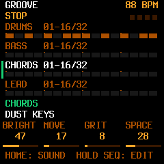
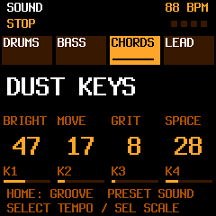
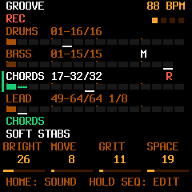

# Groove and Sound Home views — 2026-10-14

This implements part two of the [first device feedback](../FIRST_DEVICE_FEEDBACK.md#2-sequencer-prominence-two-home-views)
and the [two-Home-view specification](../HOME_VIEWS_PLAN.md).

## Behavior

JamBox starts on GROOVE. A short HOME tap while on either ordinary Home view
switches GROOVE ↔ SOUND. HOME from another page returns to the last Home view;
a short tap in settings closes through the existing menu-close path without
switching again. The choice lasts for the powered session. HOME holds, held
layers, layer locking, recorder overlays and confirmation gestures retain
priority. Switching visible Home views preserves playing notes and overdubs.

GROOVE draws four literal 16-step windows in Drums/Bass/Chords/Lead order.
Each has its own range, length and playback cursor; nonstandard divisions,
ties, mute, solo and recording have separate indications. Stopped windows are
retained, clamped on length changes and reset on whole-pattern replacement.
Sound browsing leaves them alone. Both views keep the same knobs, playable
keys, selected sound and macro parameters. Drawing uses bounded cached strips,
without adding a full-screen device framebuffer.

Actual renderer output, rather than the planning wireframe:

| GROOVE | SOUND |
| --- | --- |
|  |  |

## Build and checks

- `sh tests/run_jam_tests.sh`: 435 palette checks and 423 Home UI checks
  passed, including LCD bounds, both views' controls, partial/long patterns,
  cached redraws and view round trips. Native/WASM chord audio matched exactly;
  capture, bass overdub, replay, drum edits and bounded queues passed.
- `sh tests/run_jam_emu_tests.sh`: 118 native emulator checks, 115 dedicated
  HOME-navigation checks and the actual Chromium/AudioWorklet suite passed.
  Coverage includes both release orders for SEQ/HOME, simultaneous PLAY,
  recorder ownership throughout a gesture, immediate HOME after leaving settings
  from a locked layer, held notes/chords, uninterrupted
  overdub, remembered page/menu returns and the existing chord-tone LEDs.
  Desktop, mobile and standalone-with-network-blocked checks passed.
- Renderer screenshots were inspected at the device's 240×240 resolution.
  Both views identify the current view and opposite HOME destination.
- `bash tools/cloud/build_device.sh --with-updater` passed: app
  **551,160 / 581,564 bytes**, ordinary RAM **80,744 / 98,304**, pool
  **324,580 / 344,064**. RAM text still has 884 instructions without calls;
  register-access checks passed. The app grows by 3,228 bytes and ordinary RAM
  by 96 bytes relative to the sounding-note-light build.
- Firmware: `jamboxfm-0.1.0-dev.fwsc`, **611,255 bytes**, identity `FM-1_700`;
  SHA-256 `d3571e8286ffc0c333729e7003db99d29b24a845ae823d07b3ddf065193ba780`.
- Installer controller/shared transport: **44 checks passed** on the final
  candidate, including complete simulated factory and normal-JamBox transfers.
- Publication integration: **15 checks passed** on the final expanded package.
  The read-only device page passed **18 Chromium cases** and its outgoing-packet
  allowlist checks. The expanded package contains exactly 50 allowed files,
  including firmware, corresponding source, receipt, descriptors and notices.

The receipt binds the build inputs and compiler to the candidate. Hardware/release flags
remain false, persistence remains disabled, and physical FM-1 audition of this
increment remains outstanding. No physical device was accessed from the cloud.

## Publication

Pending final expanded-package checks and GitHub Pages deployment verification.
